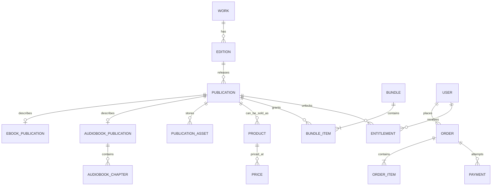

# Architecture and initial domain model

## Repository and runtime

This is one repository with two independently built applications:

- `apps/api`: Laravel 13 on PHP 8.5, PostgreSQL, Redis queues monitored by Horizon, and Filament at `/admin`.
- `apps/mobile`: React Native 0.84 Community CLI with TypeScript and native iOS/Android projects. The native projects are intentional: Readium runs in Swift and Kotlin.
- `docs`: decisions and API contracts shared by both applications.

Laravel remains a modular monolith. Modules share one deployable, one database, and Laravel's queue, while each module owns its HTTP adapters, application actions, domain rules, and persistence code. No module calls another module's controllers. Cross-module behavior goes through an application action or domain event.

```text
Mobile app
   │ HTTPS /api/v1 (Sanctum bearer token)
   ▼
Laravel modular monolith ─── PostgreSQL
   │                            │
   ├── Redis / Horizon jobs ────┘
   ├── Chapa payment adapter
   ├── private S3-compatible storage + CDN
   └── Filament publishing and operations panel
```

## Domain hierarchy



- **Work** is the intellectual title and its stable identity.
- **Edition** carries language, translator/revision, publisher, and publication year.
- **Publication** is one usable format for an edition: ebook, audiobook, or physical reference. Format-specific details live in subtype tables.
- **Product** is the commercial offer. It points to one publication or one bundle and never doubles as an access check.
- **Price** is a dated, currency-specific price row stored in minor units. Orders copy the applied price and title into an immutable line snapshot.
- **Order** records intent and line snapshots. **Payment** records one gateway attempt and verification evidence.
- **Entitlement** is the only access decision. It points to the publication granted and records its source (purchase, bundle, subscription, promo, referral reward, admin grant, gift, or physical redemption). A bundle expands into one entitlement per publication.

## Initial relational shape

The first migrations establish these records; optional marketplace and social tables are deferred.

| Area | Initial tables | Boundary |
| --- | --- | --- |
| Identity | `users`, Sanctum `personal_access_tokens`, `devices` | Contact methods and device sessions; each device can be revoked without changing the account. |
| Catalog | `works`, `editions`, `contributors`, `work_contributors`, `edition_contributors`, `publishers`, `publications`, `ebook_publications`, `audiobook_publications`, `audiobook_chapters`, `publication_assets`, `categories`, `work_categories`, `collections`, `collection_works` | Editorial metadata and format-specific delivery details. Samples are asset roles, not duplicate publications. |
| Commerce | `products`, `prices`, `bundles`, `bundle_items`, `orders`, `order_items`, `payments`, `entitlements` | Offers, price history, payment attempts, and access grants remain separate. |
| Library | `downloads`, `device_licenses`, `reading_progress`, `listening_progress`, `annotations`, `reviews` | Device-scoped offline state and user-owned reading/listening state. |
| Referrals | `creators`, `referral_campaigns`, `referral_links`, `referral_attributions`, `discount_rules`, `promo_codes`, `commissions` | Server-side attribution and commission lifecycle tied to verified paid orders. Payout rails can be added later. |

Integrity rules:

- A publication belongs to one edition and has one format. The edition's work is reached through that relation.
- A product targets either one publication or one bundle. Bundles contain publications through `bundle_items`.
- A paid `order_item` stores the exact publication IDs it grants. Later bundle edits cannot alter a past purchase.
- An entitlement is unique for `(user, publication, source type, source key)`; issuing the same verified source twice is harmless.
- A payment has a unique merchant transaction reference and provider event reference. Webhook delivery is at-least-once, so processing is idempotent.
- `publication_assets` store private object keys and processing state, never public master-file URLs.
- Prices and totals use integer minor units plus ISO currency; provider decimal amounts are converted at the gateway boundary.

## Laravel module layout

```text
apps/api/app/Modules/
  Identity/       authentication, OTP, device registration
  Catalog/        works, editions, publications, search, curation
  Publishing/     asset intake, processing jobs, publication workflows
  Commerce/       products, prices, bundles, orders
  Payments/       gateway interface, Chapa adapter, webhook verification
  Library/        entitlements, protected delivery, progress, annotations
  Referrals/      attribution, discounts, commissions
```

Each module may contain `Http`, `Application`, `Domain`, and `Infrastructure` folders as it grows. Filament resources call module application actions, so admin writes use the same validation and publishing rules as API writes.

## Mobile boundaries

`apps/mobile/src` separates navigation, features, design-system primitives, API/server state, offline persistence adapters, and secure storage. TanStack Query owns remote state; navigation and ephemeral screen state stay in React; local progress/download work stays in an offline repository/outbox; session tokens and Readium/LCP secrets stay in native Keychain/Keystore-backed storage. Readium packages stay behind `src/native/readium` adapters.

## Search and home curation

Start with PostgreSQL full-text search over work titles, edition titles, contributor names, series, categories, and subjects. Keep query construction behind Catalog so a search service can be introduced only if measured latency or relevance requires it. Home shelves are ordered `home_sections` with a typed source (collection, query, or pinned works), visibility window, and position; Filament owns curation.
